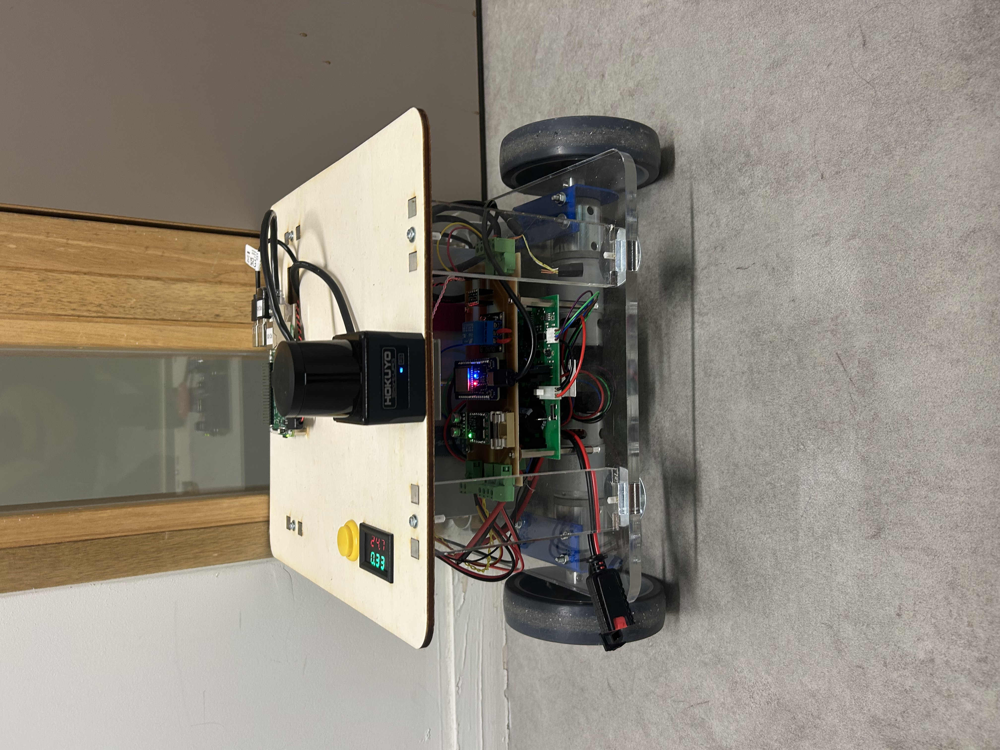
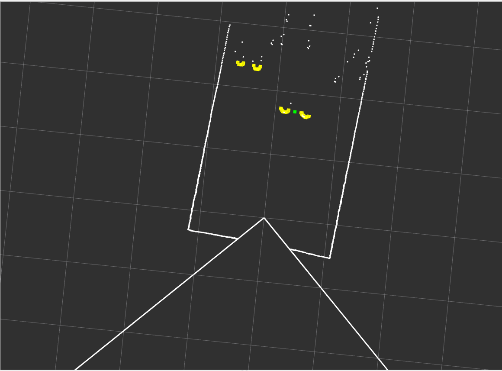
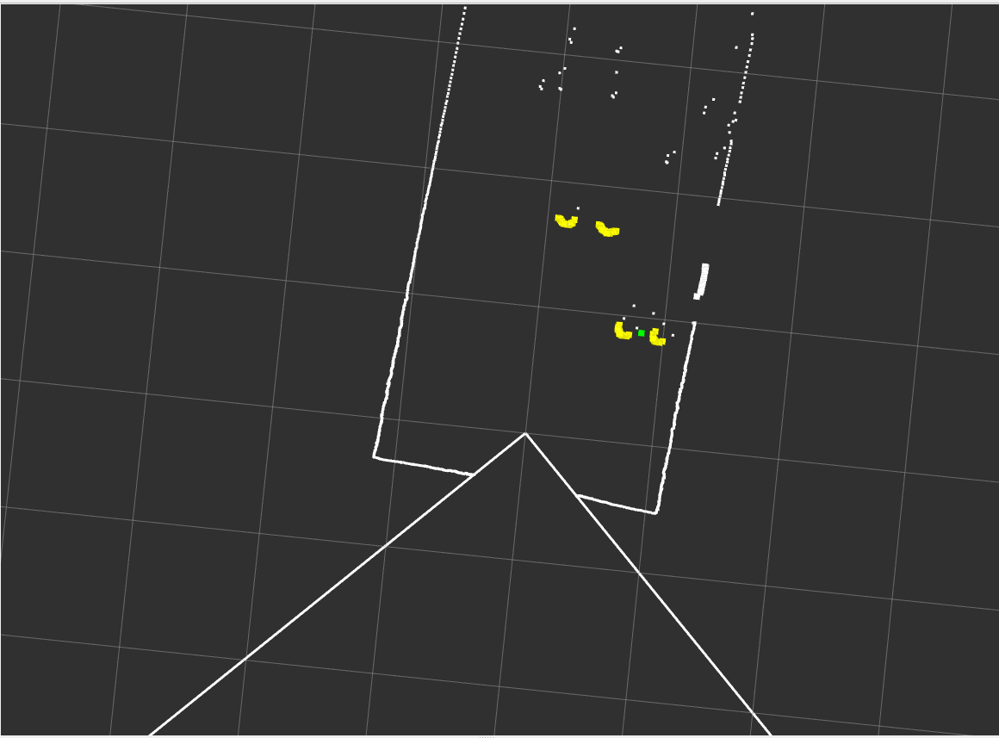
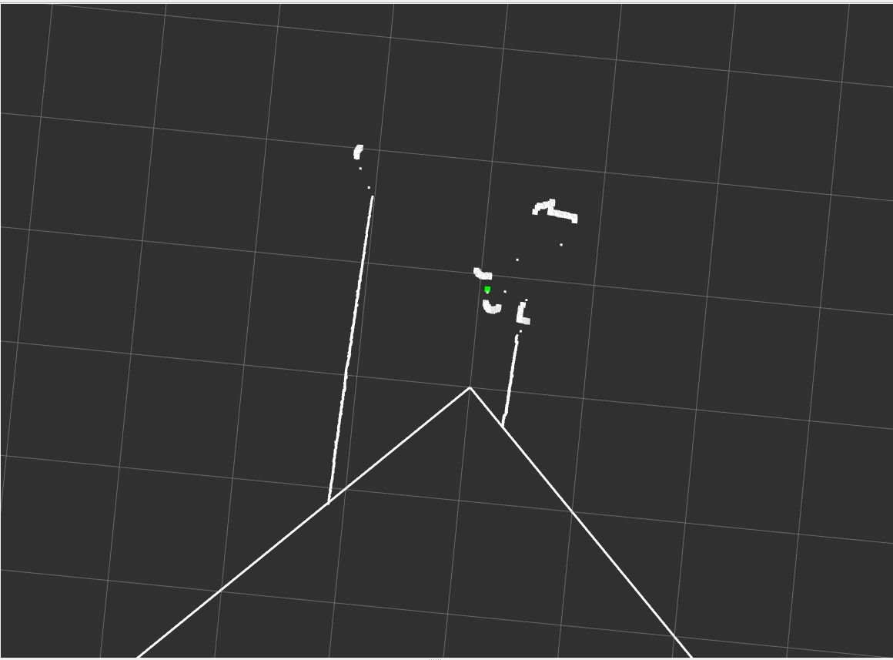
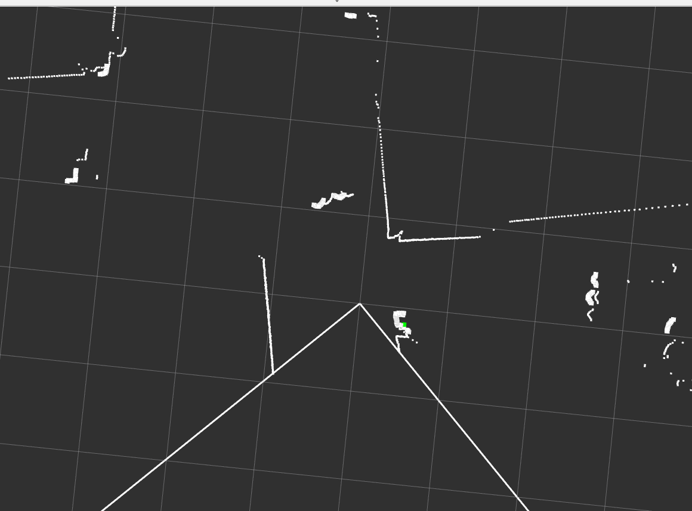
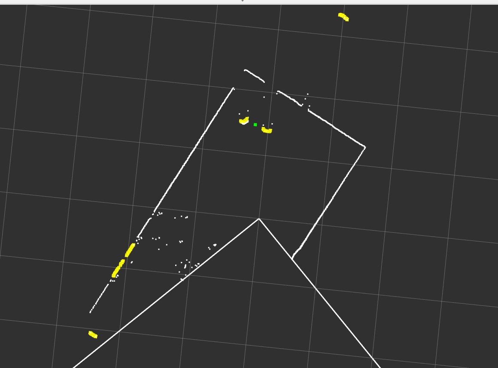
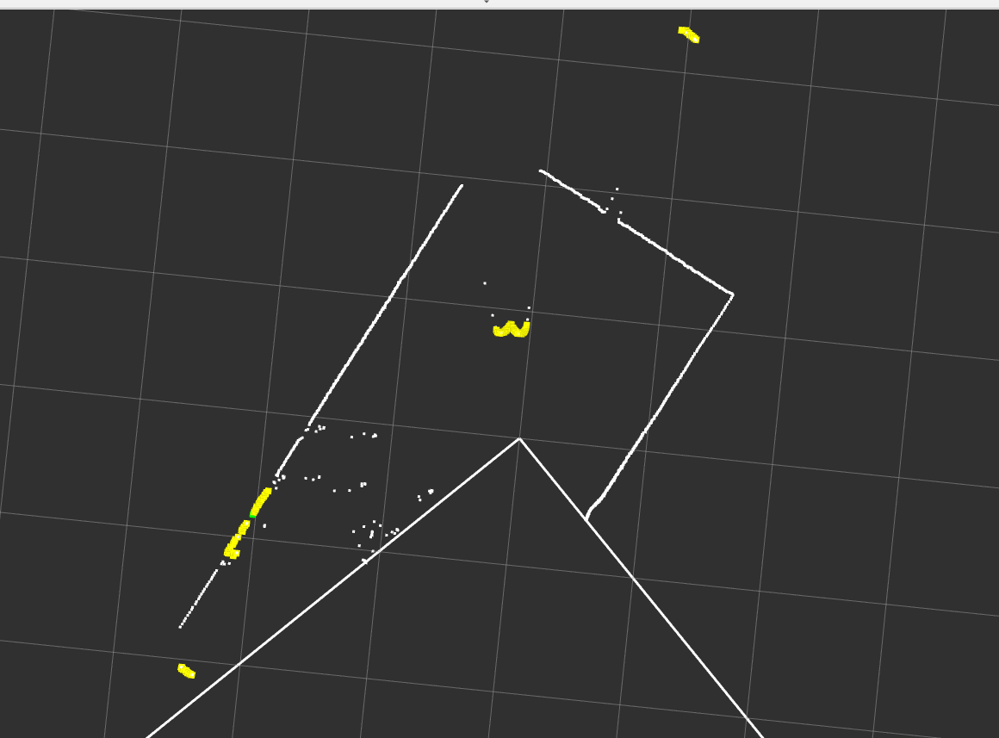

# RobAIR Follow-Me - LiDAR Detection and Tracking

**ROS 2 / C++ | 2D LiDAR | Mobile Robotics, Grenoble INP - Ense3, 2025-2026**

**Team:** Leo Gabelli, Thomas Darnault and Yonatan Tamiru Asfaw.

Implemented and evaluated a DATMO (Detection and Tracking of Moving Objects) pipeline for autonomous pedestrian following on RobAIR. The academic report connects observed robot behaviour with the assumptions in motion detection, clustering, leg pairing, person detection and track association.

## Explore the project

- [Detection and tracking evaluation](#detection-and-tracking-evaluation)
- [Three investigated scenarios](#scenario-1---occlusion-and-target-switching)
- [Source snapshot and integration](#source-snapshot-and-integration)
- [Full academic report](project_robair%20(1).pdf)
- [Original result figures](results/)

## Detection and tracking evaluation

| Evaluation group | Cases | Reported observations |
|---|---:|---|
| Detection | 9 | Cases 01-08 report successful person detection/classification, with detection ending when the person disappears in Case 02. Case 09 records occasional initial locking onto static objects, although the actual person is detected. |
| Tracking | 5 | Tracking is reported in all five cases; Cases 01 and 05 need an adaptation period, and Case 03 notes an association error near a false leg. |
| Additional investigations | 3 | Occlusion-induced target switching, stale predictions after a sharp turn, and merged leg clusters when feet are together. |

These are documented **test-case counts**, not a measured detection rate or a claim of flawless tracking. The report notes an approximately **5 s** initial lock in the static-object case; this is an observed behaviour, not a validated latency guarantee.

## Scenario 1 - occlusion and target switching

**Setup:** a second person passes between the robot and its tracked pedestrian, close enough to fall within the association gate. The report describes repetitions with different person/robot distances and crossing paths, without giving a trial count.

| Before the crossing | After the crossing |
|---|---|
|  |  |

**Result:** a short isolated loss can be tolerated, but a nearby crossing person may be selected during reacquisition. Once the track has switched, the robot can continue following the wrong person even when the original pedestrian reappears.

**Explanation:** nearest-position association within a fixed spatial gate does not preserve identity when two candidates are close. The screenshots illustrate the report's observation; they do not provide a quantitative identity-switch rate.

**Proposed next steps:** combine spatial gating with motion direction/velocity, balance the reacquisition radius against normal pedestrian motion, or maintain multiple identity hypotheses. These are proposed changes, not completed results.

## Scenario 2 - sharp turn and a stale predicted target

**Setup:** one pedestrian makes a sharp corridor turn or passes a doorway, leaving the LiDAR field of view; no other moving person is present.

| Before the turn | After disappearance |
|---|---|
|  |  |

**Result:** the RViz target marker persists for several scans. Track frequency decreases while uncertainty increases; the robot may continue towards the outdated prediction or hesitate before stopping.

**Explanation:** the frequency/uncertainty mechanism is tolerant of brief losses but cancels a fully lost track too slowly in this scenario. The report does not quantify stopping distance or timeout.

**Proposed next steps:** reset after a defined number of unassociated scans, limit unsupported prediction distance, and stop at the last confirmed target position. These safeguards require implementation and validation.

## Scenario 3 - feet together and merged leg clusters

**Setup:** the tracked pedestrian remains at the same distance while moving from a normal stance to feet almost touching.

| Legs separated | Feet close together |
|---|---|
|  |  |

**Result:** two leg clusters merge into one. The merged return can still satisfy the single-leg size threshold, producing **1 detected leg and 0 detected persons** under the required two-leg pairing rule.

**Explanation:** fixed clustering distance and mandatory leg pairing cause a visible person to disappear from the detector. This is a model-assumption limitation, rather than proof that the LiDAR cannot see the person.

**Proposed next steps:** test a guarded single-leg hypothesis or split a large cluster using its internal range profile. These alternatives were discussed, not shown as implemented fixes.

## Source snapshot and integration

- `datmo.cpp`: DATMO implementation.
- `datmo.hpp`: node declarations, interfaces and configuration constants.
- `project_robair (1).pdf`: original academic report.
- `results/`: original robot photo and six scenario snapshots.

The header references ROS 2 `rclcpp`, `sensor_msgs`, `visualization_msgs`, `geometry_msgs`, `std_msgs` and `nav_msgs`. This is a source snapshot, not a complete standalone ROS package: `package.xml`, `CMakeLists.txt`, launch files and the full platform workspace are not supplied. Integrate with the original RobAIR/course workspace. No new build or robot run was performed for this gallery.

## Attribution and figure provenance

The report and `main.tex` credit Leo Gabelli, Thomas Darnault and Yonatan Tamiru Asfaw. The photograph and screenshot files are copied from the supplied `project_robair` folder without changing their contents. Scenario-specific captions here replace the repeated generic caption in the LaTeX source, which incorrectly describes all three image pairs as the crossing-person case. `PROVENANCE.json` records original file hashes. Existing platform/source ownership is retained; no new software license is assigned.
